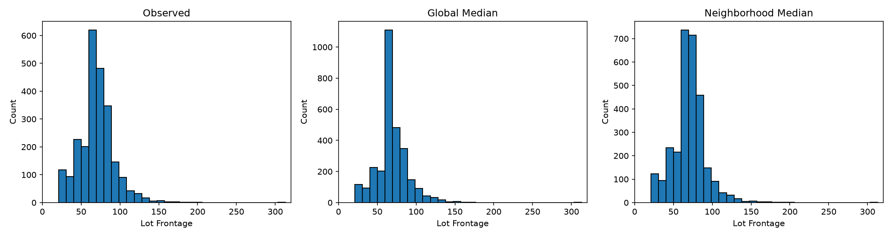

# HW5 Report — Ames Housing Data Quality and Leakage

## 1. Provenance

The dataset is the Ames Housing dataset described by De Cock (2011), *Ames, Iowa: Alternative to the Boston Housing Data as an End of Semester Regression Project*, Journal of Statistics Education, 19(3). The original tab-delimited data were obtained from https://jse.amstat.org/v19n3/decock/AmesHousing.txt, with documentation from the same source. The dataset contains 2,930 observations and 82 original columns. The download script preserves an existing raw file without overwriting it. The retrieval date and applicable reuse terms should be verified and recorded before submission.

## 2. Validation: Failures on the Raw File

Validation checks covered the 82-column schema, numeric and categorical constraints, and cross-column consistency. The raw dataset failed two checks:

| Rule | Violations |
|---|---:|
| Year Built > Yr Sold | 1 |
| Year Remod/Add < Year Built | 1 |

The cleaning process marks the conflicting year values as missing rather than inventing replacements. All 2,930 records are retained. The processed dataset passes the implemented validation rules. Passing these checks does not establish that all data values are correct.

## 3. Sentinels and Structural Absence

The dataset distinguishes structural absence from genuinely unknown values. For example, `"NA"` in certain basement, garage, and amenity fields indicates that a feature does not exist, rather than an unrecorded measurement. These structural markers were converted to the explicit category `"None"`. Empty cells were retained as missing values. The loading procedure uses `keep_default_na=False` and `na_values=[""]` to avoid incorrectly treating meaningful `"NA"` strings as nulls.

## 4. Keys and Duplicates

Both `Order` and `PID` were checked for missing and duplicate identifiers; each was unique across all 2,930 records. No duplicate rows were found. A neighborhood lookup was joined using `validate="many_to_one"`; the join preserved the original row count and matched all neighborhood codes.

## 5. Missingness Mechanism

`Lot Frontage` is missing in 490 observations (16.72%), while `Garage Yr Blt` is missing in 159 (5.43%). Among the latter, 157 observations have no garage, representing structural absence; two detached-garage records have unknown construction years.

For `Lot Frontage`, median lot area differs between observed and missing groups (9,248.5 versus 10,397.5), as does median sale price ($157,500 versus $173,000). Missingness also varies substantially by neighborhood. These associations make MCAR less plausible and support MAR as a working assumption, although MAR cannot be established from observed data alone and MNAR cannot be excluded.

## 6. Imputation Strategy and Defense

| Metric | Observed | Global Median | Neighborhood Median |
|---|---:|---:|---:|
| Standard deviation | 23.3653 | 21.3264 | 21.7185 |
| Correlation with Lot Area | 0.4913 | 0.3628 | 0.3891 |

Neighborhood-median imputation accounts for local differences in lot frontage and preserves more of the observed variation and association with lot area than global-median imputation. A global-median fallback handles neighborhoods without observed frontage values. However, both methods reduce dispersion, and neither can recover unknown true values with certainty. The comparison is descriptive rather than proof of imputation accuracy. For predictive evaluation, imputation parameters must be learned using training folds only.

## 7. Leakage-Safe Evaluation

The prediction target was `log(SalePrice)`. Linear regression was evaluated with five shuffled folds (`random_state=5110`) using RMSE.

| Method | Mean RMSE | SD |
|---|---:|---:|
| Baseline: median imputation inside pipeline | 0.1594 | 0.0138 |
| A: SalePrice-quintile imputation before CV | 0.1593 | 0.0140 |
| B: neighborhood imputation before CV | 0.1594 | 0.0138 |
| C: neighborhood imputation inside CV pipeline | 0.1594 | 0.0138 |

Method A leaks target information because `SalePrice` determines the imputed values. Method B uses information from validation folds when calculating neighborhood medians on the full dataset. Method C learns imputation statistics within each training fold, avoiding this leakage. The observed RMSE differences are negligible at the reported precision, but similar scores do not make the leaking methods valid.

## 8. What This Data Cannot Tell You

Observed associations do not establish causal relationships or prove a missingness mechanism. The true values of missing lot frontage measurements are unavailable, so imputation accuracy cannot be directly verified. The dataset also cannot establish whether the results generalize to other cities or housing markets. Cross-validation estimates predictive performance under the chosen sampling and modeling assumptions, not guaranteed future performance.